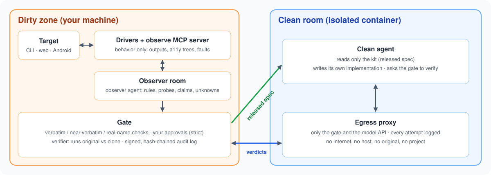

<div align="center">

# Teardown

### Clean-room reimplementation by black-box observation.

**See a feature you like. Rebuild it from how it behaves, never from its code.**

[](pyproject.toml)
[](#how-teardown-works)
[](#what-you-can-analyze)
[](CHANGELOG.md)
[](LICENSE)

[Quick start](#quick-start) · [How Teardown works](#how-teardown-works) · [What you can analyze](#what-you-can-analyze) · [Results](#results) · [FAQ](#faq) · [Documentation](#documentation)

<code>uv run teardown demo</code>

</div>

> [!IMPORTANT]
> Teardown is early software (0.2). You declare the purpose of every analysis at intake and own its legal
> assessment. Read [Responsible use](#responsible-use) first.

<div align="center">

<br />



<br /><br />

</div>

---

See a feature in an app that you want in your own product? Teardown lets you rebuild it **without ever looking at
its implementation**. One agent, the *observer*, studies the app as a black box. It records what the app accepts,
refuses and defaults to, what it does at the edges, and how its screens are sequenced. Teardown turns that into
falsifiable rules and claims and releases them as a sanitized spec. A second agent, the *clean implementer*, sees
only that spec and writes its own implementation. It can check its work against the original, but it only ever
gets back abstract pass/fail verdicts.

The valuable knowledge about a feature is behavioral. Tracing the implementation through binaries, minified
bundles or obfuscated code is slow, brittle, and copies expression you don't want. Teardown never captures code,
decompilation or stack traces. What it cannot observe becomes an explicit *unknown*, not a silent gap.

Both sides can run **enforced, not just instructed**. The observer works in a container whose only way to the
target is Teardown's drivers. The implementer works in a container that sees only the spec. Every crossing goes
through the gate and is recorded in a signed, hash-chained audit log.

## Quick start

### Install

```bash
uv tool install "teardown[web] @ git+https://github.com/lemonadesaltbagel/teardown"   # Python 3.12+
teardown install-browser                   # Chromium for web targets
teardown demo                              # observe -> gate -> clean -> verdict on a built-in example
```

`pip install "teardown[web] @ git+https://github.com/lemonadesaltbagel/teardown"` works too. Once a release is on
PyPI, the package is just `teardown[web]`. Docker is needed for CLI targets (each run is isolated in a container)
and for the enforced rooms; an installed copy builds the room images from files it carries. Android needs the SDK
and an emulator or device reachable through `adb`.

To work on Teardown itself, use a checkout: `git clone https://github.com/lemonadesaltbagel/teardown.git`, then
`uv sync` and `uv run teardown ...`.

### Set up your agent

Register the observe server with your agent (Claude Code shown; any MCP client works):

```bash
claude mcp add teardown-observe -- uv run --directory /path/to/teardown teardown observe --project /path/to/project
```

Then ask:

```text
Open web:http://localhost:3000/ as a research target and follow the observe_target playbook:
discover the UI, probe every field, inject API faults, state rules, close the coverage gaps
and release the spec.
```

The playbook ([docs/observer-playbook.md](docs/observer-playbook.md)) is served as the `observe_target` MCP
prompt; the observer guide ([docs/observer-guide.md](docs/observer-guide.md)) details every tool.

### Review and release

```bash
teardown review  --project P --feature F           # gate findings by class, coverage gaps
teardown approve --project P --feature F --by you@example.com --class expected-output --reason test-oracle
teardown release --project P --feature F
teardown export-clean --project P --out KIT        # the kit: released spec + build/verify scaffolding
```

In strict mode every release needs your approval at a terminal, and the observer's tools cannot approve
anything. In practice that is a few class-level decisions per release: approve the app text the clone must
reproduce, approve the action names, acknowledge the coverage gaps the observer explained
([docs/strict-gate.md](docs/strict-gate.md)).

### Rebuild in the clean room

```bash
teardown cleanroom up    --project P --kit KIT --claude-token-file ~/.config/teardown-claude-token
teardown cleanroom check --project P               # isolation probes, run from inside the container
teardown cleanroom shell --project P -- claude     # the implementer sees only /kit; `verify` asks the gate
teardown cleanroom down  --project P
```

`teardown observerroom` confines the observer the same way
([docs/clean-runtime.md](docs/clean-runtime.md)).

## How Teardown works

1. **Observe.** Drivers run the target and capture behavior only: outputs and file effects for CLIs,
   accessibility trees and API exchanges for web apps, accessibility trees for Android. A *mapper* turns each
   observation into a compact, wording-agnostic symbol. For web apps that symbol is versioned (`web.aria/v9`)
   and records everything a user-facing Playwright test can tell apart.
2. **Generalize.** UI discovery crawls every screen. The observer probes fields by equivalence class and
   boundary, injects faults (server errors, network failures, malformed bodies, unreadable files, airplane
   mode) and states rules in its own words. Teardown checks every rule against the original and records it as
   corroborated or falsified. Coverage lists what is left: each control, field, endpoint × fault, data state
   and live output, every route signed in and signed out, and record pages in each status. A release is
   refused until every item is exercised or explained.
3. **Gate.** The release is checked for copied expression (verbatim and near-verbatim matches against everything
   observed and every ingested document) and for real names, which become a codename. In strict mode, findings
   need your recorded approval.
4. **Rebuild.** The clean agent builds from the spec and asks the gate to verify its build. The gate runs the
   original and the clone through the same tests and returns pass/fail with abstract symbols, never the
   original's text or evidence.

## What you can analyze

| Target | What Teardown observes | Faults it can inject | Requirements | Status |
|---|---|---|---|---|
| Command-line tools | Exit code, stdout, diagnostic presence and errno class, file effects | Closed/full stdio, unreadable files, read-only directories | Docker (isolated runner) or local | **Stable** |
| Web apps | Everything a user-facing Playwright locator or assertion can tell apart (the accessibility tree with roles, names, levels, states and nesting; field values and properties; titles, focus, status messages, landmarks text), plus API method/path/status and public-contract selectors | 5xx, network failure, timeout, malformed body, pending requests | Playwright Chromium; optional backend reset command | **Working**: 96.9–99.2% of hidden tests on the last three held-out apps (see Results) |
| Android apps | Controls by role and name with state flags, visible text, system dialogs | Network off (airplane mode) | Android SDK, emulator or device via `adb` | **Working** |
| Linux desktop apps | AT-SPI tree: windows, controls, text, list items | — | Docker (Xvfb + AT-SPI container) | Experimental |
| macOS, Windows, iOS | — | — | — | Not started |

Teardown refuses to bypass protections and never captures implementation-tier data (see
[Responsible use](#responsible-use)).

## Results

Each result was scored on a hidden test suite the observer never saw, against the original's own score under
the same harness. How the evaluation works, and every result with its caveat, is in
[docs/evaluation.md](docs/evaluation.md).

| target | hidden suite |
|---|---|
| A command-line tool no model has seen | **397/397** from the spec alone |
| Web apps no model has seen (the last three held-out apps) | **129/130, 126/130, 125/127** |
| Android apps no model has seen | **113/118** and **100/119** (the second built without any verification feedback) |
| RealWorld "Conduit" web frontend (tooling tuned against it) | 99/101 |
| Flipt v1.61.0, a real open-source web app, on its own suite | 9/55: an application many times larger, with tests partly coupled to its markup (see the evaluation notes) |

- **The clones reproduced their specs.** What the hidden suites caught were things the spec did not contain.
- **The web abstraction is built from a principle.** It records every difference a user-facing Playwright
  locator or assertion can see, checked by an audit of page pairs that must differ and pairs that must not.
- **The strict-gate rounds took a few class-level decisions** at the person's own terminal per release. The
  audit log records each one.
- **Famous targets measure the model's memory too.** On `jq`, the same model with no spec at all did as well as
  with it. That is why the benchmarks use apps written for the purpose.

## FAQ

<details>
<summary><strong>Which agents can use Teardown?</strong></summary>

Any agent that supports MCP. The observe server runs over stdio or HTTP (`teardown observe --port`). The
enforced rooms ship a container with Claude Code and register only the room's Teardown server. Any other agent
that can run in the container and use a proxy works too.

</details>

<details>
<summary><strong>Does Teardown read the target's code?</strong></summary>

No. Drivers capture behavior-tier data only. Stack traces are redacted at capture, Android resource ids and
activity names never enter observations, and web API bodies are reduced to value-free shapes. In the observer
room, the observer agent cannot reach the target's files, bundles or the internet at all: only Teardown's tools.

</details>

<details>
<summary><strong>How is the clean side kept clean?</strong></summary>

The implementer's container mounts only the kit. Its only network peer is an egress proxy that allows the gate
and the model API. The gate accepts only clones built from the kit and returns abstract verdicts. Unexpected
errors come back generic, so dirty-side detail cannot leak through them. `cleanroom check` proves the isolation
from inside the container.

</details>

<details>
<summary><strong>What about the model's own memory?</strong></summary>

No container can close that gap. If the implementer's model already knows the target, part of the result is
memory. Teardown asks implementers whether they recognized the target and reports it. The uncontaminated
benchmarks use apps written for the purpose.

</details>

<details>
<summary><strong>Does Teardown upload my app?</strong></summary>

Teardown runs locally. Your agents send their tool results to their model provider, which has its own data
policy.

</details>

<details>
<summary><strong>Is reimplementing a product this way legal?</strong></summary>

That depends on your jurisdiction, the target's terms and what you build. Teardown records your declared
purpose and shows applicable warnings, but it does not give legal advice. A clean room addresses copying of
expression. It does not address patents, trademarks or trade dress.

</details>

## Documentation

- [Observer playbook](docs/observer-playbook.md): the loop the observer agent follows (also an MCP prompt).
- [Observer guide](docs/observer-guide.md): driving the dirty side for CLI, web and Android targets.
- [Strict gate](docs/strict-gate.md): reviewing findings and approving releases.
- [Clean runtime](docs/clean-runtime.md): the enforced clean room and observer room.
- [Evaluation](docs/evaluation.md): the benchmark method and every result with its caveats.

## Responsible use

Teardown never:

- bypasses CAPTCHAs, bot protection, certificate pinning, root or attestation checks, or FLAG_SECURE;
- flips Electron fuses or re-signs binaries;
- uses fake accounts or exceeds configured rate limits;
- captures implementation-tier data (code bodies, decompilation, stack traces).

These refusals are not configurable. Observe only software you are allowed to observe, within its terms. You
declare your purpose at intake and own the legal assessment.

## Contributing

Issues and pull requests are welcome. See [CONTRIBUTING.md](CONTRIBUTING.md) for the ground rules, and report
anything that could let information cross the clean-room barrier privately through [SECURITY.md](SECURITY.md).
Changes are listed in [CHANGELOG.md](CHANGELOG.md).

```bash
uv sync
uv run ruff check src tests
uv run pytest -q    # Android and desktop tests run when an emulator / the desktop image is available
```

## License

[Apache License 2.0](LICENSE). See [NOTICE](NOTICE).

The license covers Teardown's own code and documents. Teardown grants no rights in the software you analyze:
observing a target, and building and distributing anything from what you observed, remain subject to that
target's terms and the law that applies to you.
